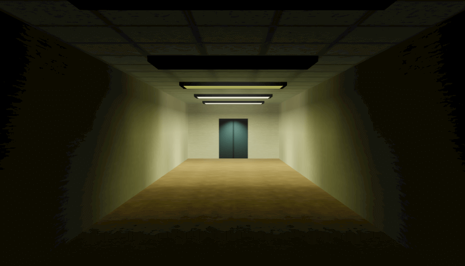

# Sector3f

Quick tech demo experimenting with 2D physics in 3D FPS environment using React + ThreeJS + Box2D. Published at: https://line-ctrl.itch.io/sector3f-demo.



## Getting started

Requirements: Node + Yarn.

```
yarn install
yarn start
```

`yarn start` runs webpack-dev-server (see `webpack.config.js`) and opens the demo; click the canvas to lock the pointer, then WASD + mouse to move.

Textures/models are not checked into the repo. `webpack.config.js` points `ASSETS_DIR` at a local folder (currently a hardcoded Windows path) that's copied to `assets/` and served statically — repoint it to wherever your art assets live before `yarn start`/`yarn dist` will work.

`yarn dist` produces a production build in `dist/` and zips it, ready for itch.io.

## Architecture, in brief

Levels are authored as JSX, not modeled in an external tool. Each level is a tree of boxes combined with CSG booleans and baked into one static mesh at load time, then lightmapped in-browser.

- **CSG authoring** (`src/csg.tsx`): `<CSGContent>` wraps a plain Three.js mesh (usually a `<boxGeometry>`) and converts it to a `three-csg-ts`/JSCAD polygon soup on mount. `<CSGOp type="union|subtract|intersect|inverse">` combines its children's shapes into one, and nodes nest arbitrarily. `<CSGRoot>` unions everything that bubbles up to it, inverts it (CSG solids model empty space, so the level interior is the inverse of the union of "wall" boxes), and emits one merged `BufferGeometry` tagged per-face with a material index.
- **UVs** (`src/uvProjection.ts`): since CSG output has no meaningful UVs, `applyUVProjection` box-projects UVs per vertex from world position + face normal (biggest-axis triplanar pick) after the mesh is placed.
- **Floor/physics** (`src/levelMesh.tsx`): once the CSG mesh is ready, up-facing polygons (by material, via `floorMaterialList`) are pulled out, unioned in 2D with JSCAD, and turned into Box2D chain shapes for the floor collision body, plus a fixture-query-based Z-height lookup (so actors on sloped/stepped floors get the right height without raycasting).
- **Lightmapper interplay** (`src/levelMesh.tsx`, `@react-three/lightmap`): `<LevelMesh>` wraps the whole level in `<Lightmap disabled>`, which stays disabled until `CSGRoot`'s `onReady` fires — i.e. until the merged geometry, floor body, and Z-query all exist. The merged geometry is also explicitly de-indexed (`toNonIndexed()`) before being handed off, because the lightmapper does its own vertex welding/UV-island seaming and needs each triangle's vertices unshared to do that correctly.

### Dynamic meshes vs CSG

Not everything is CSG. Anything that moves or is instanced per-level (elevator doors, props, the player) is rendered as an ordinary `<mesh>` alongside the level, not folded into the `CSGRoot` union — CSG only produces one static, lightmapped mesh, so anything animated has to live outside it. See `src/level/Elevator.tsx` for the pattern:

- Static parts of a fixture (elevator shaft walls, floor) still go through `<CSGContent>` like the rest of the level.
- Moving parts (doors) are plain meshes with their own material/texture, driven either by Box2D (`<Body isKinematic>`, which sets velocity each tick to chase the mesh's target transform) or by `react-spring` for purely visual animation (or both, as with the doors).
- Since these meshes aren't part of the baked mesh, they opt out of baking explicitly: `<LightmapReadOnly>` keeps a dynamic mesh present during the bake pass (so it still occludes/bounces/emits light onto the static scene) but skips generating UV2/a lightmap for it, so it keeps rendering with its own material rather than the baked result. `<LightmapIgnore>` goes further and removes content from the bake pass entirely (e.g. an extra real-time-shadow-casting light that only exists for a moving door and shouldn't factor into the baked lighting at all).
- Collision for dynamic meshes goes through the same `<Body>`/`<Sensor>` components as everything else (`src/physics.tsx`), independent of the CSG-derived floor body.
